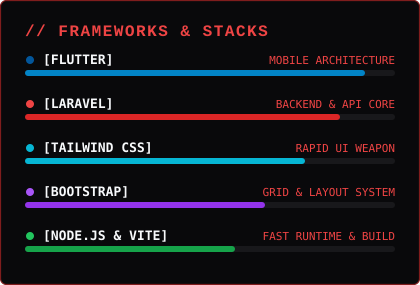

  

  

 

## ⚡ TECH MATRIX &amp; LANG BREAKDOWN

  <table border="0">
    <tr valign="top">
      <td>
        
      </td>
      <td>
        
      </td>
    </tr>
  </table>
  
   
  
  

    
  

 

## 💀 GITHUB TELEMETRY &amp; STREAK

  <table border="0">
    <tr valign="top">
      <td>
        
      </td>
      <td>
        
      </td>
    </tr>
  </table>

 

---

  

